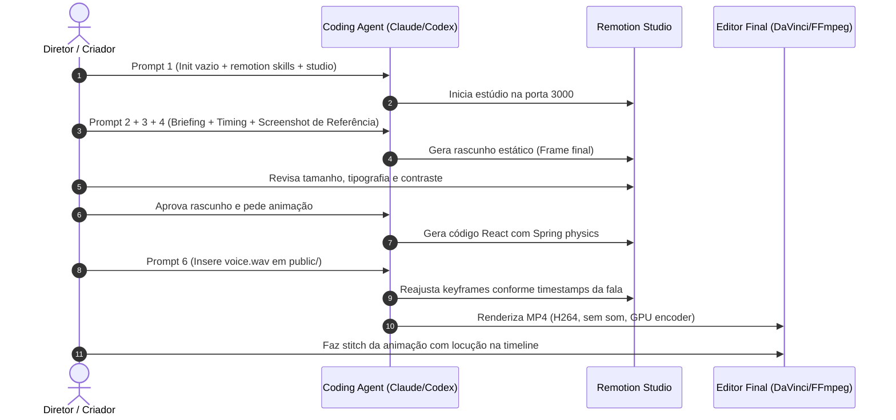

# Metodologia Extraída: Motion Design Didático com Remotion & Coding Agents (Viktor Kav)

**Vídeo Analisado:** [How I turn an explanation into an animation with AI](https://www.youtube.com/watch?v=Uwpc-z1KppU)  
**Autor:** Viktor Kav (`@VKav`)  
**ID do Vídeo:** `Uwpc-z1KppU`  
**Duração:** 19 min 55 s (1195 s)  
**Fontes Primárias (REA Evidence Ledger):** `research/videos/Uwpc-z1KppU/transcript.tsv`, `frames/frame_0001.png` a `frame_0120.png`, `manifest.json`.

---

## 1. Princípio Técnico & Arquitetura de Execução
> **Evidence IDs:** [EVD-VKAV-01], [EVD-VKAV-02]

* **"Vídeo é Código React Renderizado Frame a Frame" [DITO NO ÁUDIO: 04:59–05:24]:**  
  Viktor Kav não utiliza modelos de vídeo generativos (Sora, Runway, Pika) para ensaios explicativos devido à falta de consistência temporal e incapacidade de manter diagramas exatos entre cortes. Ele utiliza o **Remotion** (React + TypeScript).
* **Controle Determinístico de Estado [DITO NO ÁUDIO: 05:33–05:41]:**  
  O código controla todos os elementos visuais por parâmetros determinísticos derivados do frame atual: posição de cards, linhas conectadas por SVG, opacidade, textos dinâmicos e nós de circuitos.
* **Ambiente Interativo de Desenvolvimento (Remotion Studio) [OBSERVADO NO FRAME: frame_0048, DITO: 05:42–05:52]:**  
  O estúdio local do Remotion roda via navegador com hot reload para permitir scrub na linha do tempo milissegundo a milissegundo.
* **Aceleração por Hardware (GPU Encoders) [DITO NO ÁUDIO: 17:04–17:34]:**  
  Renderização em CPU pura pode levar 6h30 para uma cena que leva 30 minutos em encoder de hardware dedicado (Apple Silicon VideoToolbox ou NVIDIA NVENC). Esse requisito é obrigatório nas diretrizes do agente.

---

## 2. Anatomia dos Prompts Mestres (Verbatim)
> **Evidence IDs:** [EVD-VKAV-03], [EVD-VKAV-04], [EVD-VKAV-05]

O fluxo de Viktor Kav emprega uma esteira sequencial de 6 prompts altamente especializados:

### Prompt 1: Setup do Ambiente e Injeção de Skills [DITO: 07:29–07:49]
```text
Confirme o caminho dessa pasta e verifique se meu computador e a versão do node atendem aos requisitos do Remotion.
Crie aqui dentro um projeto Remotion chamado recompilações-demo usando o modelo vazio.
Instale as skills oficiais do Remotion nesse projeto e abra o Remotion Studio em seguida.
```

### Prompt 2: O Argumento Didático em 3 Estados de Causa e Efeito [DITO: 08:48–09:36]
```text
Simule a troca de dados entre um jogo enquanto software e um console enquanto hardware sendo decompilados e adaptados para rodar no PC.
O arquivo do jogo continua no centro, as ligações que iam para os serviços do console passam para implementações no Windows.
O trabalho de tradução, no entanto, ainda não está completo: o pedido de áudio, por exemplo, fica sem resposta, mostrando que ainda falta implementar.
```
*Regra de Ouro:* Todo ensaio didático modela **3 estados**: (1) Estado Inicial $\rightarrow$ (2) Transição Sequencial de Elementos $\rightarrow$ (3) Evidenciação de Limitação ou Gargalo.

### Prompt 3: Especificação Temporal da Composição [DITO: 09:48–10:11]
```text
Crie uma composição chamada relincagem-demo com 16 segundos de duração, resolução de 1920x1080 pixels e 30 quadros por segundo.
Nos primeiros 4 segundos, apresente o estado inicial.
Até o segundo 11, mude as três ligações, mostre a falha de áudio e reserve os 5 segundos finais para a leitura.
Antes de produzir, confirme o seu entendimento e proponha a composição.
```

### Prompt 4: Direção de Arte com Imagem de Referência [DITO: 11:35–11:53]
*(Anexando um screenshot da referência visual desejada)*
```text
Use a ideia de circuitos e conexões da imagem anexada.
Mantenha o arquivo central grande com textos legíveis e os destinos separados.
Diferencie a ligação atendida da ligação de áudio que ficou sem resposta.
Mostre primeiro um rascunho parado da imagem final para que eu possa conferir o tamanho e a posição dos elementos antes de animar.
```
*Invariante:* **Stills antes de movimento.** Nunca anime antes de aprovar o layout estático.

### Prompt 5: Refinamento Iterativo de Pacing e Legibilidade [DITO: 13:42–14:08]
```text
Separe a mudança das três ligações: faça sistema, controle e imagem se moverem em sequência e sustente cada destino antes do próximo.
Aumente o rótulo de controle e dê espaço para LKB.
Remova o título redundante que repete o que a fala e a imagem já explicam.
```

### Prompt 6: Sincronização Voice-First [DITO: 15:45–15:59]
*(Salvando a gravação de voz crua em `public/voiceexemplo.wav`)*
```text
Meça os tempos dessa fala (public/voiceexemplo.wav).
Ajuste a composição para que as ligações mudem exatamente quando eu descrevo a mudança na fala, e o pedido de áudio do jogo fique sem resposta quando eu menciono essa limitação.
Preserve o tempo final de leitura.
```

---

## 3. Diretrizes de Storytelling e Direção Didática
> **Evidence IDs:** [EVD-VKAV-06]

1. **Economia de Estímulos:** Se fala, texto na tela e animação transmitem a mesma coisa, remova o texto na tela para diminuir a carga cognitiva do espectador [DITO: 14:02].
2. **Escalação em Lote (Piloto $\rightarrow$ 4 Peças $\rightarrow$ Lote Completo) [DITO: 14:19–14:38]:**
   - Aprova 1 cena piloto estática e animada.
   - Gera 4 cenas variadas para testar consistência do Design System.
   - Somente após aprovação das 4 peças, libera a geração de todas as cenas restantes do roteiro.
3. **Design System Híbrido [DITO: 12:15–12:23]:**
   - 70% identidade contínua do canal (tipografia, paleta padrão, bordas).
   - 30% temática específica do vídeo (ex: circuitos para emulação, tamagotchis para assistentes de IA).

---

## 4. Esteira Operacional Passo a Passo
> **Evidence IDs:** [EVD-VKAV-07]



---

## 5. Lacunas e Omissões [DESCONHECIDOS REA]

* **Omissão 1: Medição Automática de Timestamps do Áudio:**  
  O vídeo mostra o autor passando `voice.wav` ao Claude Code e dizendo "se o agente não conseguir localizar, marco os tempos no editor e informo à mão" [DITO: 16:11–16:20].
  * *Solução AIDD:* Nosso projeto já possui o `faster-whisper` integrado com timestamps segundo a segundo no `transcript.tsv`, automatizando 100% dessa etapa sem marcação manual.
* **Omissão 2: Renderização em Lote de dezenas de cenas:**  
  Viktor exporta arquivos individuais pelo Remotion e joga no DaVinci Resolve manualmente.
  * *Solução AIDD:* Podemos orquestrar o render do Remotion diretamente via CLI e concatenar as cenas com o FFmpeg demuxer de forma totalmente programática.
