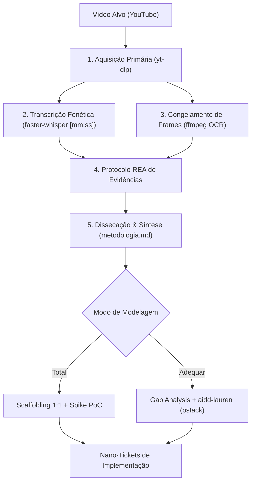

# Manual Oficial: Engenharia Reversa Metodológica de Vídeos do YouTube

**Versão:** 1.0.0  
**Padrão:** AIDD / REA (*Reverse Engineer Anything*) + `aidd-lauren` (*pstack*)  
**Finalidade:** Dissecação cirúrgica, extração de regras, evidências primárias, modelagem determinística e geração de tickets a partir de vídeos técnicos e tutoriais.

---

## 1. Fundamentos e Filosofia

Vídeos de criadores técnicos de ponta (ex: Viktor Kav, Matt Penny, theguneytopcu) são frequentemente "caixas-pretas" metodológicas: eles mostram o produto final polido e pequenos relances do fluxo de trabalho, mas omitem parâmetros essenciais, prompts e armadilhas de implementação.

A **Engenharia Reversa Metodológica** trata o vídeo como um **artefato compilado** a ser desconstruído com rigor de engenharia de software:



### O Papel Central do REA (*Reverse Engineer Anything*)
O REA estabelece a regra da **proveniência estrita**: nenhuma suposição pode ser tratada como fato. Toda afirmação técnica no relatório final deve estar vinculada a uma evidência formal:

* **`[OBSERVADO NO FRAME]`**: Código, prompt, nó de timeline ou comando visível na tela em frame de alta resolução.
* **`[DITO NO ÁUDIO]`**: Frase ou instrução declarada pelo autor na transcrição com minutagem indexada (`[mm:ss]`).
* **`[DERIVADO]`**: Conclusão técnica necessária para que o resultado ocorra (ex: se há bloom no WebGL, há um passe de pós-processamento).
* **`[DESCONHECIDO]`**: Omissão ou segredo do autor. O agente tem proibição estrita de inventar detalhes omitidos; ele deve registrá-los como incógnitas e formular hipóteses testáveis.

### O Papel do `aidd-lauren` (*pstack*)
Quando a metodologia extraída precisa ser incorporada a um projeto já existente (`--modo adequar`), acionamos o framework da Lauren Tan:
* **`principle-model-the-domain`**: Modela a arquitetura de dados antes de escrever código de renderização.
* **`principle-prove-it-works`**: Cada novo recurso precisa ser provado com um artefato real executável (ex: render de vídeo de 5 segundos), sem aceitar autorrelato de "deve funcionar".
* **`unslop` / `playbook-refactoring`**: Remove código redundante ou duplicado, garantindo que o novo motor se integre harmonicamente ao que já existe ([`tutorial.py`](file:///C:/Users/trcnologia/orca/workspaces/proj_stepo/feature-matt-penny/aidd-tutorial-creator/scripts/tutorial.py), [`compose.py`](file:///C:/Users/trcnologia/orca/workspaces/proj_stepo/feature-matt-penny/aidd-tutorial-creator/scripts/compose.py)).

---

## 2. Ferramental Obrigatório e Suas Funções

| Ferramenta | Papel na Engenharia Reversa | Comando / Uso |
|---|---|---|
| **`yt-dlp`** | Download em alta definição (até 1080p) e extração de áudio/metadados. | Invocado via [`video_reengineer.py`](file:///C:/Users/trcnologia/orca/workspaces/proj_stepo/feature-matt-penny/research/tools/video_reengineer.py) |
| **`faster-whisper`** | Transcrição local ultra-rápida e cronometrada segundo a segundo. | Gera `transcript.txt` e `transcript.tsv` |
| **`ffmpeg`** | Congelamento de frames em alta fidelidade para leitura de código e prompts. | Amostragem periódica ou `select='gt(scene,0.3)'` |
| **Visão / OCR** | Leitura de prompts, JSONs, estruturas de diretório e interfaces de IA exibidas na tela. | Inspeciona frames capturados |
| **MCP REA** | Decompilação de web bundles, repositórios ou demos web citadas no vídeo. | `analyze_web_bundle`, `trace_web_module_imports` |

---

## 3. Guia Operacional Passo a Passo

### Passo 1: Execução da Extração Primária
Para extrair um vídeo (ex: Viktor Kav `Uwpc-z1KppU`), execute no terminal:

```bash
python research/tools/video_reengineer.py "https://www.youtube.com/watch?v=Uwpc-z1KppU" --intervalo-frames 10 --whisper-model small
```

**Resultado gerado:**
* `research/videos/Uwpc-z1KppU/info.json` (metadados e descrição original)
* `research/videos/Uwpc-z1KppU/transcript.tsv` (transcrição com timestamps)
* `research/videos/Uwpc-z1KppU/frames/*.png` (frames visuais prontos para OCR)
* `research/videos/Uwpc-z1KppU/manifest.json` (catálogo REA inicial)

### Passo 2: Extração de Frames de Destaque
Se um frame específico contém um prompt ou tela crucial (ex: aos 3 min e 45 s):
```bash
python research/tools/video_reengineer.py "Uwpc-z1KppU" --mark 225 "prompt_claude_code"
```

### Passo 3: Invocação do Agente de IA com o Prompt Mestre
Dispare o prompt padronizado (disponível em [`research/templates/PROMPT_ENG_REVERSA_MESTRE.md`](file:///C:/Users/trcnologia/orca/workspaces/proj_stepo/feature-matt-penny/research/templates/PROMPT_ENG_REVERSA_MESTRE.md)) preenchendo as flags desejadas.

---

## 4. Dicionário Completo de Flags de Personalização

| Flag | Opções | Descrição e Comportamento |
| :--- | :--- | :--- |
| `--alvos` | URLs / IDs | Lista de 1 a N vídeos para análise. |
| `--pesquisa-gringa` | `"termo de busca"` | Executa pesquisa de vídeos internacionais em inglês sobre o tema, selecionando os 3 maiores benchmarks para cruzamento de dados. |
| `--modo` | `total` \| `adequar` | **`total`**: Scaffolding do zero replicando 100% da metodologia.<br>**`adequar`**: Realiza gap analysis contra o projeto indicado e projeta apenas os deltas. |
| `--projeto-alvo` | `<caminho_absoluto>` | Caminho do projeto atual a ser atualizado (obrigatório se `--modo adequar`). |
| `--profundidade` | `macro` \| `cirurgica` \| `frame-a-frame` | **`macro`**: Foca em conceitos e arquitetura.<br>**`cirurgica`**: Extrai parâmetros exatos, prompts e código visível.<br>**`frame-a-frame`**: Analisa cortes cena a cena com timing de transições. |
| `--extrair-prompts` | `true` \| `false` | Se ativo, força a transcrição literal e reconstrução do catálogo de prompts exibidos na tela. |
| `--stack-alvo` | `remotion` \| `threejs` \| `gsap` \| `auto` | Restringe ou direciona a modelagem técnica para o framework especificado. |
| `--gerar-spike` | `true` \| `false` | Implementa um protótipo executável mínimo em `spikes/spike_poc/` provando a técnica no ambiente local. |
| `--gap-analysis` | `true` \| `false` | Produz a matriz `research/gap_analysis.md` com análise de ROI, tokens e complexidade vs. a base existente. |

---

## 5. Estrutura dos Entregáveis (Scaffolding Padrão)

Toda engenharia reversa completa produz a seguinte árvore determinística:

```text
research/
├── metodologia.md                     # Síntese exaustiva da metodologia
├── gap_analysis.md                    # Matriz de diferenças (se modo adequar)
├── ESTADO.md                          # Proveniência REA (Evidence Ledger e Gates)
├── tokens_design.json                 # Springs, easings, tipografia e cores
├── templates/                         # Templates reutilizáveis do projeto
├── tools/                             # Scripts Python de suporte
└── videos/
    └── <video_id>/
        ├── manifest.json              # Metadados do vídeo e IDs de evidência
        ├── transcript.tsv             # Transcrição tabular com timestamps
        ├── prompts_extraidos.txt      # Prompts transcritos do vídeo
        └── frames/                    # Frames estáticos de alta resolução
tickets/
├── BACKLOG_METODOLOGIA.md             # Visão geral e grafo DAG de execução
└── nano-tickets/                      # Micro-tickets cirúrgicos (Tracer Bullets)
    ├── TK-01-scaffold-motor.md
    ├── TK-02-presets-fisica.md
    └── TK-03-sincronia-audio.md
spikes/
└── spike_poc/                         # Protótipo funcional provando a execução
```

---

## 6. Governança e Regras Negativas (Invariantes)

1. **PROIBIDO ALUCINAR:** Se o criador não mostrou como resolveu a sincronia ou um asset específico, rotule obrigatoriamente como `[DESCONHECIDO REA]` e proponha alternativas técnicas.
2. **ZERO STUBS EM TICKETS:** Nenhum nano-ticket pode ter como comando de validação `echo ok` ou `exit 0`. O comando de validação deve ser um teste automatizado ou script que efetivamente renderiza ou valida o código.
3. **ISOLAMENTO DE CONTEXTO:** Cada nano-ticket deve ser autossuficiente para ser executado por um agente em uma nova janela de contexto limpa.
