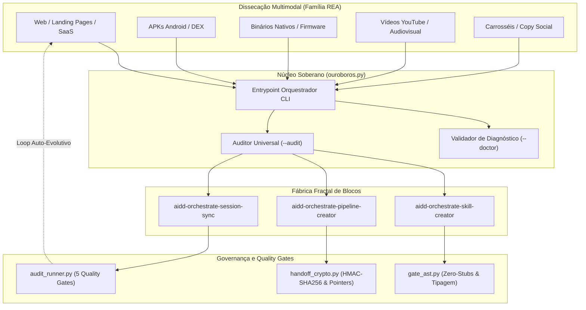
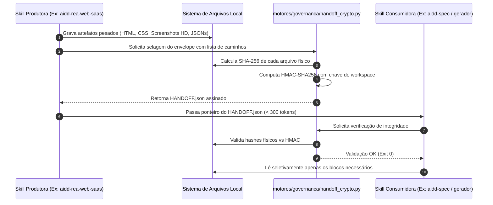
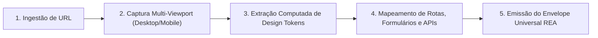

# Dossiê Técnico Executivo: Arquitetura & Governança AIDD Ouroboros

> **Status:** Auditado & Homologado (Exit 0) | **Quality Gate:** 100% Verde (86 arquivos validados) | **Data:** 25/10/2026

---

## 1. Visão Executiva & Propósito Soberano

O **AIDD Ouroboros** é uma plataforma e meta-framework autônomo voltado à **engenharia reversa multimodal e síntese determinística de código**. Inspirado no símbolo do *Ouroboros* (o dragão/serpente que consome e recria a própria cauda), o sistema opera como um ciclo contínuo e auto-evolutivo (*flywheel soberano*): disseca produtos digitais em produção (Web/SaaS, APKs Android, binários nativos, vídeos e carrosséis sociais), extrai seus *design tokens*, rotas e lógica estrutural, e os reconstrói com código limpo, tipado e auditado, sob governança criptográfica imutável.





---

## 2. Pilares Arquiteturais Invioláveis


| Pilar                       | Regra Canônica                        | Impacto Prático no Desenvolvimento                                                                                                   |
| --------------------------- | ------------------------------------- | ------------------------------------------------------------------------------------------------------------------------------------ |
| **Determinism First**       | AST & Motores Locais > Raciocínio LLM | Ferramentas mecânicas geram IDs, hashes, schemas e validações antes de qualquer invocação de LLM.                                    |
| **Pointer Architecture**    | Economia Extrema de Tokens (< 500t)   | Arquivos brutos ou vídeos nunca são despejados no contexto. A troca ocorre via manifestos com `path` e `sha256`.                     |
| **Zero Stubs / Zero Mocks** | Bloqueio via AST Gate                 | Funções com `pass`, `TODO`, `...` ou `NotImplementedError` em módulos de negócio causam falha imediata no audit.                     |
| **Handoffs Criptográficos** | Assinatura HMAC-SHA256                | Toda transição entre nós de pipeline gera um `HANDOFF.json` assinado que valida integridade física do disco.                         |
| **Governança Fractal**      | Anatomia Enterprise Obrigatória       | Proibida a criação manual/ad-hoc. Toda skill ou pipeline nasce com `references/`, `templates/`, `scripts/`, `RULES.md` e `sync.ps1`. |


---

## 3. Topologia e Mapa Fractal de Diretórios

O repositório `[proj_aidd-ouroboros](file:///c:/Users/trcnologia/Desktop/_inbox/proj_aidd-ouroboros)` organiza-se em camadas rigorosamente desacopladas:

&nbsp;

&nbsp;

```
proj_aidd-ouroboros/
├── ouroboros.py                 # Orquestrador soberano e entrypoint único da CLI
├── setup.ps1                    # Script de setup e sincronização multi-harness
├── AGENTS.md                    # Diretrizes soberanas e limites de governança
├── README.md                    # Documentação conceitual do sistema
│
├── motores/                     # Motores determinísticos de infraestrutura e governança
│   ├── governanca/              # Quality gates, integridade criptográfica e verificações
│   │   ├── audit_runner.py      # Executor dos 5 quality gates do ecossistema
│   │   ├── gate_ast.py          # Verificador sintático AST (zero stubs, tipo estrito)
│   │   ├── handoff_crypto.py    # Gerador/validador de envelopes com HMAC-SHA256
│   │   ├── dependency_resolver.py # Resolução determinística de dependências entre skills
│   │   ├── credentials.py       # Gatekeeper seguro de variáveis de ambiente
│   │   └── gate_baseline.json   # Linha de base e métricas de integridade
│   ├── geradores/               # Motores de compilação de código e templates
│   └── orquestracao/            # Execução de DAGs e transições de estado
│
├── aidd-pipelines/              # Pipelines composíveis organizados em grafos DAG
│   ├── _e2e-smoke/              # Pipeline de teste de fumaça E2E contínuo
│   ├── canal-dark-avatar/       # Pipeline completo de síntese de vídeo com avatar
│   └── video-to-tutorial/       # Engenharia reversa de vídeo para tutorial técnico
│
└── docs/                        # Registros históricos e especificações de execução
    └── v2-execution/
        └── LEDGER.md            # Ledger imutável de transações e deploys
```

---

## 4. O Mecanismo Criptográfico de Handoff (Pointer Architecture)

Para evitar consumo excessivo de tokens e garantir rastreabilidade forense, a comunicação entre skills segue o protocolo estrito de ponteiros locais:





> [!NOTE]
> Se qualquer byte de um arquivo referenciado for alterado externamente no disco, o validador de `handoff_crypto.py` detecta divergência no HMAC e aborta a execução do pipeline (Circuit Breaker).

---

## 5. Matriz dos 5 Quality Gates do Ouroboros

Executados via `python ouroboros.py --audit` (ou diretamente em `[audit_runner.py](file:///c:/Users/trcnologia/Desktop/_inbox/proj_aidd-ouroboros/motores/governanca/audit_runner.py)`):


| Gate                            | Verificação                                                    | Critério de Sucesso                                                         | Status na Última Execução |
| ------------------------------- | -------------------------------------------------------------- | --------------------------------------------------------------------------- | ------------------------- |
| **[1/5] AST & Zero-Stubs**      | Inspeciona a árvore sintática (AST) de todos os arquivos `.py` | Proibido `pass`, `TODO`, `...` ou blocos vazios não justificados            | **APROVADO (86/86)**      |
| **[2/5] Micro-Frontmatter**     | Analisa os arquivos `SKILL.md` das skills                      | O campo `description:` deve possuir no máximo 25 palavras                   | **APROVADO**              |
| **[3/5] Governança AGENTS.md**  | Verifica arquivos `AGENTS.md` em cada módulo/skill             | Limite rígido de concisão (< 450 palavras por arquivo)                      | **APROVADO**              |
| **[4/5] Completude Anatômica**  | Circuit breaker da fábrica fractal de componentes              | Presença obrigatória de `references/`, `templates/`, `scripts/`, `RULES.md` | **APROVADO**              |
| **[5/5] Testes Reais (Pytest)** | Execução da suíte completa de testes automatizados             | 100% dos testes verdes sem mocks de código de negócio                       | **APROVADO**              |


---

## 6. Fluxo Especializado: Engenharia Reversa Web & SaaS (`aidd-rea-web-saas`)

Frente prioritária alinhada na entrevista socrática para reconstrução de páginas e landing pages:





1. **Ingestão:** Recebimento e validação de conectividade via `[web_reengineer.py](file:///C:/Users/trcnologia/.gemini/config/skills/aidd-rea-web-saas/scripts/web_reengineer.py)`.
2. **Captura Visual:** Renderização headless e geração de screenshots HD (1920x1080 e 375x812).
3. **Extração de Tokens:** Extração via CDP/DevTools das variáveis CSS computadas (paleta, tipografia, espaçamentos, sombras e border-radius) em `TOKENS_DESIGN.json`.
4. **Mapeamento Estrutural:** Identificação de hierarquia DOM, componentes de formulário, botões de ação (CTAs) e chamadas assíncronas (XHR/Fetch) em `estrutura_ux.md`.
5. **Canonização & Handoff:** Assinatura do `MANIFEST_REA.json` via HMAC para consumo imediato por skills construtoras de código limpo.

---

## 7. Próximos Passos Operacionais Recomendados

> [!TIP]
> Com a auditoria em **Exit 0**, o ecossistema está em estado ideal para processamento.

- **Execução Real de Demonstração:** Submeter uma URL de teste ao `[aidd-rea-web-saas](file:///C:/Users/trcnologia/.gemini/config/skills/aidd-rea-web-saas/SKILL.md)` para gerar os primeiros tokens e o `HANDOFF.json`.
- **Criação de Novo Pipeline Canônico:** Provisionar um pipeline oficial `web-to-clean-code` utilizando `aidd-orchestrate-pipeline-creator` para encadear a dissecação web diretamente com a síntese de código limpo.
- **Sincronização de Sessão:** Registrar este marco e o ledger factual executado através do `[aidd-orchestrate-session-sync](file:///C:/Users/trcnologia/.gemini/config/skills/aidd-orchestrate-session-sync/SKILL.md)`.
